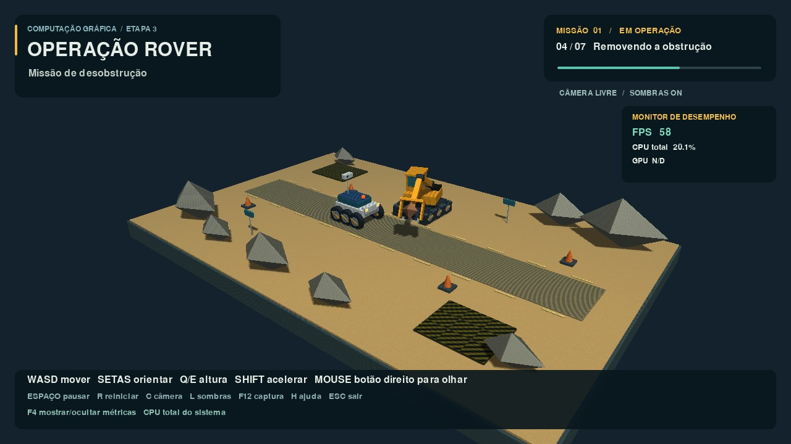

# Operação Rover — Missão de Desobstrução

Trabalho de Computação Gráfica, Etapa 3, 2026/02. **Leucimar Tiago da Silva Carvalho**. Trabalho individual autorizado pelo professor. Temas: **15 — escavadeira de brinquedo** e **18 — rover explorador**.



Um rover percorre um terreno de testes, detecta uma rocha e solicita apoio. A escavadeira desloca a base, aproxima a caçamba, recolhe a rocha e libera o caminho. O rover aguarda o encerramento da operação antes de prosseguir. O ciclo de 35 segundos se repete com transição escura. A rocha é um objeto de cenário; não há terceiro personagem, física ou colisões.

## Instalação e execução no Windows

Use **Python 3.12 de 64 bits** e uma placa/driver com **OpenGL 3.3 ou superior**. O ambiente Linux de desenvolvimento foi efetivamente testado com Python 3.12.14, Pygame 2.6.1, PyOpenGL 3.1.10 e NumPy 2.3.5. A atualização também passou por execução automatizada no Windows com Intel Iris Xe e OpenGL 3.3. Os controles físicos e a inspeção próxima no ambiente de apresentação ainda precisam do roteiro manual de `docs/TESTES.md`.

Baixe pelo botão **Code → Download ZIP** e extraia tudo, ou clone:

```powershell
git clone https://github.com/leucimar/Trabalho_Computacao_Grafica_Etapa_3.git
cd Trabalho_Computacao_Grafica_Etapa_3
py -3.12 -m venv .venv
.venv\Scripts\python.exe -m pip install --upgrade pip
.venv\Scripts\python.exe -m pip install -r requirements.txt
.venv\Scripts\python.exe main.py
```

Os comandos usam o interpretador do ambiente diretamente e dispensam alterar a política de execução do PowerShell. No PyCharm, abra esta pasta e selecione `.venv\Scripts\python.exe` como interpretador; execute `main.py`.

A primeira instalação precisa de internet. Depois disso a aplicação usa exclusivamente arquivos locais. Não é necessário instalar Blender, Unity ou uma engine. A janela tem resolução de 1280 × 720.

## Controles

| Entrada | Ação |
|---|---|
| W / A / S / D | Mover câmera para frente, esquerda, trás e direita |
| Setas | Orientar câmera pelo teclado |
| Q / E | Descer / subir câmera |
| Shift | Acelerar câmera |
| Segurar botão direito + mover mouse | Olhar com o mouse; soltar libera cursor |
| Espaço | Pausar / retomar só a animação; câmera continua ativa |
| R | Reiniciar missão e retirar pausa |
| C | Restaurar enquadramento inicial |
| L | Alternar sombras para comparar com iluminação local |
| F4 | Mostrar / ocultar FPS, CPU e GPU |
| H | Mostrar / ocultar ajuda |
| F12 | Capturar quadro em `capturas/` |
| Esc | Encerrar |

## Recursos e organização

| Recurso | Arquivo / classe |
|---|---|
| Janela, eventos e relógio `dt` | `main.py`, função `run` |
| Rover, seis rodas e sensor | `models/rover.py`, `Rover` |
| Escavadeira, base móvel, torre, braço e caçamba | `models/excavator.py`, `Excavator` |
| Cenário e vínculo rocha–caçamba | `scene/environment.py`, `Environment` |
| Estados e interpolação por segundos | `scene/animation.py`, `Mission`, `Pose`, `State` |
| Câmera perspectiva e entrada | `scene/camera_controls.py`, `Camera` |
| Grafo, VBOs, VAOs e matrizes | `core/`, componentes didáticos da disciplina |
| Primitivas / normais / UV | `geometry/`, `LitBoxGeometry`, `CylinderGeometry`, `RockGeometry` |
| Shadow mapping real em duas passagens | `rendering/renderer.py`, `Renderer` |
| Vertex / fragment shaders | `shaders/scene.*`, `shaders/depth.*`, `shaders/hud.*` |
| Métricas assíncronas | `rendering/telemetry.py`, `PerformanceMonitor` |
| Legenda | `rendering/hud.py`, `Hud` |
| Texturas próprias e gerador reproduzível | `assets/textures/`, `tools/generate_textures.py` |

## Framework, fontes e alcance da conformidade

O projeto integra **componentes da versão didática disponibilizada pelo professor Rodrigo Fernandes dos Santos**, em [rodrygofesantos/pygame](https://github.com/rodrygofesantos/pygame), pasta `Aula_Texturas/alunos`, commit `bcc4079703c5947556563c4f2a558064e12b7242`. Os componentes copiados são identificados em [FONTES_E_ATRIBUICAO](docs/FONTES_E_ATRIBUICAO.md), com hashes para rastreabilidade. Não foram substituídos por outra engine.

**Ressalva do requisito de framework:** o próprio material da disciplina descreve essa versão como um subconjunto didático independente que segue as classes do livro, e não como o pacote oficial integral dos autores. O pacote oficial do livro não foi localizado com distribuição e termos verificáveis nesta rodada. É necessário confirmar com o professor que a versão da sua própria disciplina satisfaz esse ponto do enunciado. Não se declara equivalência integral com o código oficial. O shadow mapping foi desenvolvido como extensão dessas classes, seguindo a abordagem de duas passagens exigida pela seção 6.9.

Referência principal: STEMKOSKI, Lee; PASCALE, Michael. *Developing Graphics Frameworks with Python and OpenGL*. CRC Press, 2022. DOI: [10.1201/9781003181378](https://doi.org/10.1201/9781003181378).

## Testes e apresentação

```powershell
.venv\Scripts\python.exe -m unittest discover -s tests -v
.venv\Scripts\python.exe -m compileall -q core geometry models rendering scene tools tests main.py
.venv\Scripts\python.exe tools\verify_graphics.py
```

O teste gráfico abre um contexto real, renderiza dois ciclos acelerados e verifica profundidade, sombras, alinhamento de coleta/depósito, renderização direta na janela e ausência de erros OpenGL. Não é um benchmark nem substitui os controles manuais no Windows.

- [Guia técnico: shaders, attributes, uniforms, hierarquia e sombras](docs/GUIA_TECNICO.md)
- [Roteiro de apresentação de 10 minutos](docs/ROTEIRO_APRESENTACAO.md)
- [Checklist rastreável](docs/CHECKLIST_REQUISITOS.md)
- [Testes executados e teste manual no Windows](docs/TESTES.md)
- [Fontes e atribuição](docs/FONTES_E_ATRIBUICAO.md)

Para inspecionar uma etapa específica: `python main.py --at 15`. Para sair automaticamente: `python main.py --frames 120`. Para reduzir o custo das sombras: `python main.py --shadow-size 1024`. Os parâmetros `--at` e `--fixed-dt` são ferramentas de demonstração/teste; a execução normal usa o relógio real.

## Problemas comuns

- **`Failed to build pygame`:** confira se está usando Python 3.12 de 64 bits e o ambiente recém-criado; não reutilize um venv de Python diferente. Execute os comandos com `.venv\Scripts\python.exe`.
- **Contexto OpenGL indisponível / shader não compila:** atualize o driver oficial da placa e execute localmente. O projeto exige OpenGL 3.3 e GLSL 330; adaptadores antigos ou sessões remotas podem não oferecê-los.
- **Baixo desempenho:** tente `--shadow-size 1024` ou `512`. Não há taxa de FPS garantida para hardware não testado.
- **Arquivos ausentes:** extraia todo o ZIP. Os recursos são resolvidos a partir da pasta do projeto. `python tools/generate_textures.py` recria as quatro texturas próprias.
- **`Attempt to retrieve context when no valid context` em SDL offscreen Linux:** no ambiente de teste foi necessário `PYOPENGL_PLATFORM=egl`. Isso não deve ser configurado para a execução Windows normal.

## Autoria, contribuições e IA

Responsável acadêmico único: Leucimar Tiago da Silva Carvalho, com revisão, testes locais e apresentação individual a realizar pelo aluno. Não há divisão entre colegas.

Foi usado **ChatGPT Work / Codex** para elaboração e revisão da estrutura, geometria adicional, modelos, máquina de estados, controles, renderer, shaders, gerador de texturas, testes e documentação. Os arquivos externos em `core/` e parte de `geometry/` são atribuídos ao material do professor; não são apresentados como criação do aluno ou da IA. A assistência de IA não dispensa a revisão e o domínio do código pelo aluno. Nenhum teste no PC do aluno é declarado como já executado.

A versão atual foi simplificada: bloom, bump mapping e pós-processamento foram removidos, incluindo os shaders, os controles F1/F2/F3 e as opções correspondentes. A cena mantém texturas, iluminação, sombras e as correções de coleta/depósito da pedra.

## Monitoramento de desempenho

FPS vem do relógio do Pygame. **CPU total** mostra a ocupação do sistema, com uma casa decimal: é amostrada por 0,5 s e atualizada aproximadamente a cada segundo em um coletor próprio. No Windows, se `psutil` não estiver instalado ou a leitura falhar, usa `GetSystemTimes` para calcular a diferença dos tempos de atividade e ociosidade. A CPU atualiza sem aguardar a GPU. Até a primeira amostra válida aparece `medindo...`; fonte indisponível aparece como `N/D`.

A GPU continua sendo consultada por `nvidia-smi` ou pelo contador do motor mais ocupado do Windows, em outro coletor com timeout. `GPU motor*` não representa utilização global. Falhas em uma fonte não interrompem a outra nem o desenho da cena. F4 mostra ou oculta o painel.

A caçamba ampliada, a pedra menor e o depósito fora da pista continuam presentes. O contato é coreografado, sem simulação de colisões físicas.
